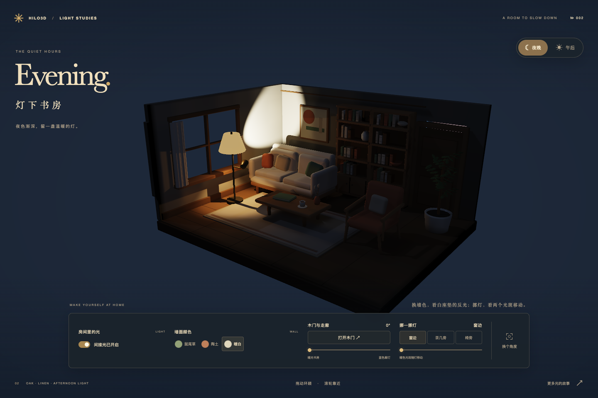
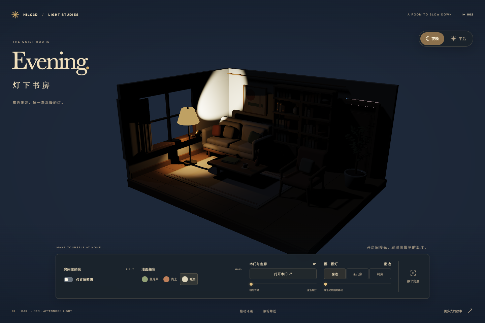
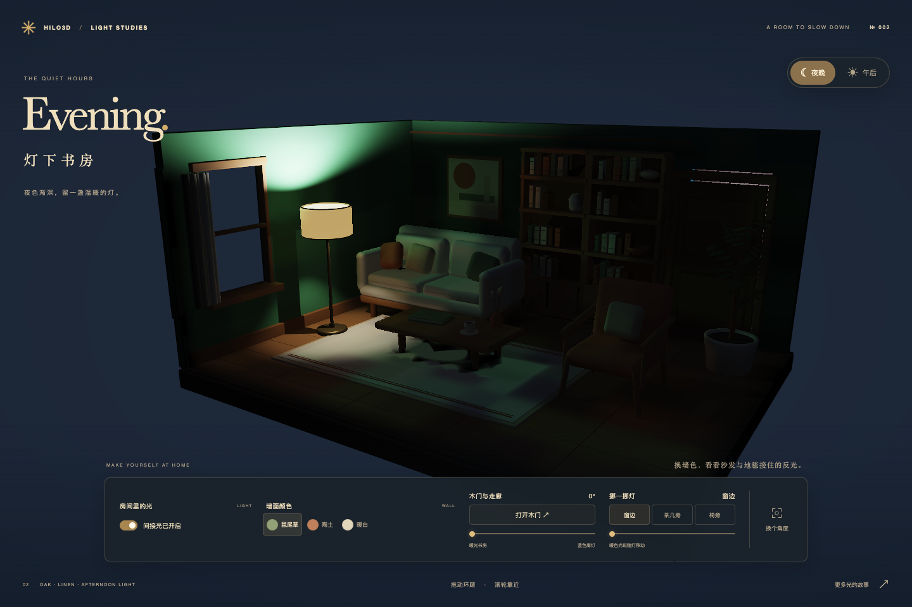
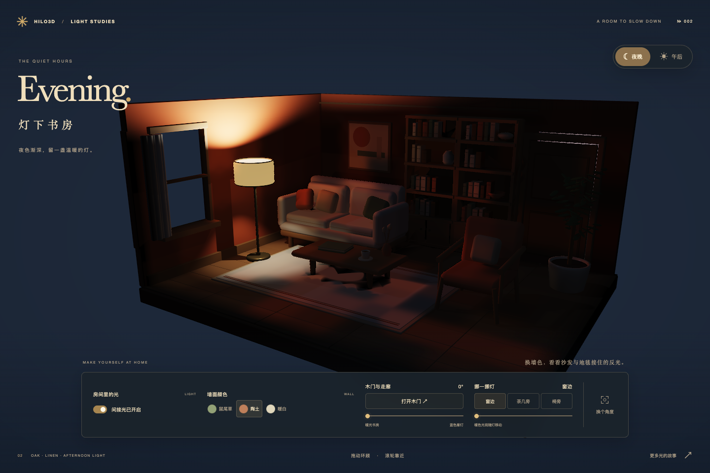

# Dynamic diffuse global illumination

The opt-in WebGPU Clustered Forward+ pipeline traces a complete, camera-independent CPU BVH from
bounded world-space irradiance probes. It transports offscreen emissive and directly illuminated
surfaces onto opaque PBR receivers. It uses the production Render Graph, storage/compute RHI and
GLSL → Naga raster path. It requires no hardware ray-tracing extension and does not add a second
renderer.

## Public entry point

```ts
const pipeline = new Hilo3d.ClusteredForwardPlusPipelineFactory({
    buckets,
    temporalAA: {},
    dynamicGlobalIllumination: {
        origin: new Hilo3d.Vector3(-3, 0.25, -2),
        spacing: new Hilo3d.Vector3(0.75, 0.65, 0.75),
        probeCounts: [9, 5, 7],
        raysPerProbe: 128,
        maxProbesPerFrame: 48,
        maxTriangles: 65_536,
        maxMeshes: 1_024,
        maxTextureTexels: 1_048_576,
        maxLights: 32,
        hysteresis: 0.9,
        bounceStrength: 0.7
    }
});

// Zero hides the contribution; probe updates continue converging.
pipeline.setDynamicGlobalIlluminationIntensity(0);
// Change the sky contribution, copying the color and restarting bounded convergence.
pipeline.setDynamicGlobalIlluminationEnvironment(new Hilo3d.Color(0.018, 0.024, 0.043));
const diagnostics = await pipeline.readDiagnostics();
```

An absent or false option creates no ray scene, probe buffer, compute pass, or hybrid surface pass.
The static creation requirements include exact buffer sizes, dispatch dimensions, nine storage
bindings for ordinary GPU Scene raster (ten with meshlet vertex pulling), and the `r32float`
generation-history marker. Explicit WebGL2 selection fails before pipeline creation. Settings are
validated and snapshotted; invalid sizes, non-finite numbers and scene/light budget overflow fail
clearly.

## Scene and material contract

The internal scene compiler traverses visible scene nodes and camera layers, independent of the
camera frustum and Hi-Z visibility. It extracts indexed or non-indexed rigid triangle geometry,
including normalized, interleaved and quantized positions and canonical built-in skin/morph poses.
Shared local geometry is cached. Exact matrix, attribute and material snapshots detect changes;
unchanged scenes retain snapshot identity and avoid triangle allocations. Geometry membership
changes rebuild a deterministic median BVH; count-preserving geometry changes and rigid transforms
refit the existing topology. Immutable triangle/BVH dirty byte ranges allow material and rigid edits
to upload only changed records. A skipped CPU revision falls back to a complete upload; rejected
submissions retry the same ranges. Failed updates leave the previous snapshot valid.

Triangle records occupy 320 bytes and carry world positions, transformed shading normals, legacy
factor diagnostics, sidedness, object layer, both logical UV sets, vertex RGBA and tangent frames.
Separate bounded material records describe the exact transport slots and world-space decals. BVH
nodes occupy 32 bytes and use explicit integer child/leaf indices. The balanced tree has bounded
traversal depth. GPU ray queries use nearest-hit triangles and light visibility rays; they do not
read visibility back to the CPU.

The default `texturePolicy: 'sample'` evaluates actual uploaded texture values for base color,
emission, metallic (separate and combined metallic-roughness), specular-glossiness, opacity, tangent
normal and RGBD light maps. UV0/UV1 selection, normalized/interleaved attributes, both quantization
decode matrices, per-slot transforms, color encoding and channel swizzles are retained. Color
encoding is applied after filtering and before channel swizzling, matching the shared material
shader. Vertex RGBA multiplies base color and coverage. Alpha masks use the same cutoff comparison
for primary rays and light-visibility rays, so masked leaves and cutouts do not become solid ray
occluders. Scalar opacity is replaced by the opacity map's red channel when that slot is present, as
in the canonical raster coverage shader.

A renderer-owned float RGBA atlas is prepared by compute from engine-managed textures through the
existing upload/cache and graph dependencies. Compressed sources first use a shared portable raster
pass to fetch exact level-zero texels into a linear `rgba32float` graph texture; compute then copies
that normalized image into the atlas. This avoids compressed compute-read recovery failures observed
on software WebGPU while preserving hardware-sRGB decoding, alpha and normal channels without an
extra half-float quantization step. The raster shader generates logical top-left UVs and crosses the
managed-image boundary once; directional fixtures cover both raster backends. Only changed or
recovered compressed assets record this pass; stable frames record no normalization or atlas copy.
This keeps compressed textures, images, partial updates, released CPU images and HDR values on the
ordinary resource/recovery path. It does not extract pixels with a canvas or require CPU texture
readback. The atlas holds the full level-zero image without resolution reduction, uses the authored
magnification filter and repeat/mirror/clamp addressing, and is bounded by `maxTextureTexels` (sum
of unique texture widths × heights). Ray transport deliberately samples level zero: no screen
derivatives, anisotropic footprint or ray-cone mip selection is claimed. Updates to texture content,
upload descriptors, sampler state, UV transforms, channels or encoding invalidate the appropriate
scene/atlas revisions. Automatic video texture updates require explicit revisioned texture
snapshots; unrevisioned `autoUpdate` textures fail clearly. Unsupported texture formats/dimensions
fail through graph validation.

Atlas invalidation follows the shared texture cache's effective upload source: image identity,
complete `mipmaps` array identity, content revision, upload/shape properties and sampler settings.
Retained recovery backing takes precedence after public image release; extraction never reads the
released `image` getter. Replacing an entire mip chain therefore refreshes transport even when
`updateRevision` is unchanged. Sampler changes can also force a source allocation/upload, so a
changed recipe is prepared before its synchronized external-image width/height enter atlas packing.
Stable sources perform neither repeated upload-recipe preparation nor atlas-copy passes.

As with ordinary raster texture uploads, editing pixels or replacing an entry/data field inside the
same mip-array object requires `texture.needUpdate = true`, or a supported `setSubTexture()` update.
The ray scene does not hash image bytes or silently add a stronger mutation contract. Managed
textures may be imported before the first scene/compute/fullscreen pass; those imports share one
frame upload transaction. Failed frames preserve committed data and retry without prematurely
releasing CPU recovery sources.

Standard rigid `Mesh.useInstanced` batches retain each mesh's world transform and shared local
geometry in the ray scene. Built-in `MorphGeometry` and `SkinnedMesh` also contribute current poses:
CPU extraction follows decoded positions → active morph slots → the same weighted joint matrices
used by the raster shader. Pose and stream snapshots are exact; unchanged poses retain snapshots,
while changed poses refit the bounded BVH without changing leaf identity. Joint indices, affine
matrices, complete target streams and finite nonnegative weights with a positive sum are validated.
Skin positions divide the composed matrix by that sum, matching final homogeneous clip geometry and
accepting ordinary UNORM weight rounding. Shading normals are subsequently normalized; this does not
change the raster shader's raw homogeneous varying convention. The canonical
128-joint/eight-morph-slot limits apply. This is CPU pose extraction, not a second GPU skinning
renderer. Large animated scenes must budget their triangle count and measure CPU refit cost.
Arbitrary custom GPU deformation and custom `instanceCount` vertex streams have no shared ray
deformation ABI and still fail by default.

World-space PBR decals modify ray-hit diffuse color and shading normals using the same atlas,
projector volume, layer masks, overlap order, tint, opacity, edge and angular fades. Decal mask
alpha controls surface paint, not geometric ray coverage. Camera-distance fade is a raster
presentation LOD and is intentionally absent from camera-independent transport. Roughness and
specular-only maps do not affect the Lambertian diffuse transport model; this does not claim glossy
BRDF path tracing or layered-specular transport.

Blended/transmitting surfaces, alpha-to-coverage, parallax/custom materials and custom overrides of
transport position/material bindings, area lights and authored cookie/IES spot profiles continue to
require an explicit exclusion policy. `unsupported: 'exclude'` counts deliberate omissions; omitted
geometry cannot occlude rays. An individual effect or receiver can set
`mesh.contributeToGlobalIllumination = false` to opt out of ray geometry while retaining
`unsupported: 'error'` for the rest of the scene. Submitted diagnostics count these cases in
`exclusions.disabled`; its children retain their own participation settings. This flag controls ray
contribution and occlusion only: supported PBR materials can still receive probe illumination.
Smoke/weighted particles should opt out explicitly because they are not solid ray blockers.

The legacy `texturePolicy: 'material-factor'` is an explicit coarse approximation which ignores
surface maps and decals for transport; `'exclude'` omits textured meshes and `'error'` rejects them.
Neither is described as texture-accurate transport. Exact runtime diagnostics report
encountered/excluded meshes, CPU upload bytes and persistent allocation bytes.

## Resource budgets

Persistent buffers are created during pipeline initialization, with explicit fixed caps. They do not
allocate/grow in the Render Graph record phase. Defaults are 65,536 triangles, 1,024 mesh/material
records and 1,048,576 unique level-zero texels. Triangle + BVH caps reserve 24 MiB; the complete
material/decal table reserves about 2.09 MiB; the float RGBA atlas reserves 16 MiB. Probe histories,
lights and parameters add their separately determined sizes. `residentBytes` reports the actual
owned storage-buffer sizes, including both probe histories. Image and uniform caches are counted
separately by the shared renderer; temporary retirement behind a GPU fence is not a second logical
allocation. Exceeding any cap fails before commands rather than dropping assets.

Compressed normalization adds at most `16 * maxTextureTexels` transient bytes in an invocation (16
MiB at the default cap), proportional to the changed compressed pixels actually recorded.
`rgba32float` must be renderable and loadable; blending and float32 filtering are not required.
Graph validation rejects unavailable capabilities before submission. These attachments are not part
of DDGI `residentBytes`; the shared Render Graph pool separately retains idle resources under its
own budget (256 MiB by default). Normalization shader ownership is released on construction failure
and controller destruction, and discarded frames never publish the new atlas revision.

For a small room, set `maxTriangles: 4096`, `maxMeshes: 64`, and `maxTextureTexels: 262144` when its
unique transport maps fit 262,144 texels. Those caps reserve roughly 5.63 MiB for triangles, BVH,
materials and the atlas, plus the selected probe histories. A single 1024×1024 texture already needs
1,048,576 texels; sharing a texture between slots/meshes consumes its pixels only once. The caps are
not resident texture-streaming targets, and no automatic transport downsampling is performed.

Meshlet buckets add an independent CPU geometry snapshot: 96 numeric bytes per selected triangle,
excluding JavaScript overhead, in addition to the packed DDGI records above. It is owned by the
renderer and does not count toward the asset manager's CPU page budget or the meshlet GPU arena. The
global `maxTriangles` budget is checked before snapshot allocation and includes repeated mesh
instances; source-page sharing does not make their world-space ray triangles free.

## Probe transport and visibility

Each probe stores an 8×8 octahedral irradiance field and an 8×8 directional first/second distance
moment field, plus its relocation/classification state. Rays sample the sphere and evaluate emitted
radiance, shadowed direct light and bounded feedback from the previously submitted probe field.
Radiance clamping and a feedback factor below one control bright outliers and runaway accumulation.
Each probe uses fixed, spatially decorrelated spherical quadrature. Its rays do not rotate between
static updates: irradiance, directional distance moments and relocation therefore describe the same
sampling footprint. Valid probe positions stay fixed until the scene changes. Exact submitted light
records, rather than noisy sample-luminance differences, identify real lighting changes and reset
radiance accumulation; visibility history is governed separately by geometry validity.

A strict round-robin budget updates at most `maxProbesPerFrame` probes. Unscheduled probes are
copied into the next history slot, while uninitialized probes remain invalid. Directional distance
moments, normal/view bias and visibility-weighted trilinear interpolation reduce wall leakage.
Probes inside solids or too near a surface are relocated within a bounded fraction of their cell;
relocated probes are not sampled until they have been evaluated again. Scene revisions reset
affected per-probe temporal accumulation as the scheduled updates reach them.

The volume has finite bounds and fixed resolution. Thin geometry smaller than the visibility
resolution can still require finer spacing and smaller bias. This is a diffuse solution, not glossy
reflection transport. Probe updates converge over multiple frames, and a moving light may take a
full update cycle to reach every probe. `updateCycleFrames` makes that latency explicit.

## PBR and screen-space composition

Both the fixed-bucket indirect and ordinary clustered storage PBR lanes sample the same probe buffer
in world space. Probe illumination replaces the diffuse ambient/environment baseline inside the
configured volume; direct lighting, specular lighting and emission retain their original contracts.
Unsupported Forward fallback materials do not silently become probe-aware. Combining DDGI with GTAO
or physical atmosphere requires opaque receivers registered in rigid GPU Scene buckets; the existing
ordinary clustered lane cannot share those pass bindings. An unregistered PBR receiver in that
combination fails clearly. A direct DDGI receiver also fails when its material variant budget is
exhausted, rather than losing illumination through fallback.

`GPUSceneBucket.meshlets` can receive and contribute DDGI, including alongside directional virtual
shadows and the SSGI hybrid. Transport uses a camera-independent lighting LOD: the finest resident
complete page of every group from the geometry arena staged for the current frame. This can differ
from the main view's coarser raster LOD or its whole-object visibility-overflow fallback. A missing
group switches the entire ray object to its ordinary fallback; partially loaded groups are not
silently omitted. Refinement and eviction update the canonical ray scene, preserving material UV0,
alpha masks, world transforms and offscreen participation without replacing public mesh geometry.
Only supported rigid meshlet buckets use this replacement; other content retains the scene/material
contract above. See [meshlet geometry](./MESHLET_GEOMETRY.md) for page and shadow budgets.

When SSGI is enabled alongside DDGI, an additional two-target surface pass exports the exact
outgoing probe diffuse baseline and receiver diffuse reflectance. It is separate from the normal
material/reflection MRTs, so the combination does not expand the simultaneous attachment count. The
portable SSGI trace computes a signed correction using cosine-distributed directions:

```text
coverage = sum(valid screen-hit quality) / rayCount
correction = sum(screen radiance × receiver reflectance × quality) / rayCount
             − probe diffuse baseline × coverage
final HDR = original HDR + filtered correction
```

Missed/offscreen directions preserve the probe baseline. Temporal accumulation and edge-aware
filtering retain signed values, and composition bounds negative corrections by the current probe
contribution. Hybrid intensity is bounded to a convex replacement. Screen radiance remains
view-dependent, so glossy hit radiance is an approximation; this does not claim full BRDF path
tracing. The existing standalone Forward/WebGL2 SSGI behavior is unchanged.

## Submission, recovery and ownership

Probe buffers are double buffered. The graph declares ray-scene reads, previous-probe reads,
current-probe writes and raster reads explicitly. Cursor, scene upload revision, probe slot and
submitted diagnostics advance only after a successful submission. Discarded frames do not advance
the sequence. CPU scene snapshots may be prepared early, but their GPU upload revision is committed
separately and retried after failure.

The internal meshlet geometry snapshot follows staged arena page identities. Unchanged page choices
reuse its CPU geometry; changed choices invalidate the ray-scene revision and retain the same
controller upload/dirty-range retry rules. It does not publish GPU residency or advance probes on
its own. Discarded page admissions are therefore not treated as committed DDGI geometry. Successful
ray-scene extraction releases snapshots for buckets with no contributing instances, including
removal, hierarchy/layer filtering and explicit GI opt-out; another active instance preserves the
shared cache.

A persistent graph history marker tracks device-generation validity. Device loss recreates neutral
resources, invalidates old probe history and resumes bounded convergence; CPU-shadow scene recipes
restore uploaded geometry and material records. The atlas is GPU-written and reinitialized from
managed-image recipes before any ray reads after recovery. A rejected atlas update marks the atlas
suspect until a successful submission; reverting a candidate scene therefore cannot reuse partially
overwritten ranges. Destruction uses renderer-owned, submission-aware storage resources. No native
device or command encoder crosses the RHI boundary.

## Original indoor showcase

[Atelier](../examples/dynamic_global_illumination_atelier.html) is an original Blender-authored
reading room with oak furniture, linen, books, pottery, curtains and an olive tree. It opens at
night; the afternoon preset changes direct lights, emissive surfaces and probe environment radiance
together. The [asset recipe and provenance](../examples/models/Atelier/README.md) reproduce the
model.

The floor lamp has one open linen drum, fine brass rims and recessed upper/lower diffusers. There is
no projecting auxiliary head. Its light objects are children of the exported `ReadingEmitter` (local
−Y) and `WallWashEmitter` (local +Y), keeping source position, aperture axis and beam direction
consistent when the lamp moves. The upper emitter sits above the open rim and supplies a broad
upward wash; the lower emitter sits below the shade and supplies the floor pool.

A tall, narrow window leaves a painted return in front of the sofa, where the lit wall is visible to
the front-facing cushions. Near-neutral linen and restrained direct fill let the actual colored
diffuse reflection remain visible. The probe volume starts at Y = 0.05 with 0.72 vertical spacing:
the rug is inside its full-weight bounds and the floor receives about 93% boundary weight, rather
than the previous 33%. Probe count, per-frame ray budget, exposure and GI intensity are unchanged.
No wall-dependent tinted fill or receiver recoloring is used. The showcase uses 315 probes, 128 rays
per probe and at most 48 updated probes per frame.

Receiver comparisons cover multiple sofa surfaces and the rug at landscape and compact portrait
sizes. Each wall palette is captured with GI enabled and disabled, keeping camera, direct lights and
receiver materials fixed. The measured masks exclude the painted wall and interface. Static frame
and interaction checks use the same rendered scene; these are functional pixel observations, not
performance measurements.

Native production captures sample 17,508 receiver pixels at 1440×960 and 9,231 at 716×860. Changing
chalk to sage or terracotta changes the combined sofa/rug mask by 14–17 mean RGB levels, with about
85–88% of its pixels changing by more than six levels in at least one channel. With the GI
contribution disabled, the corresponding mean changes stay below 0.08. The browser tests use
separately reviewed landscape/portrait masks and require a broad response, the expected green/red
channel direction and a near-zero disabled control. Their reduced `?test=1` backing resolution is
kept separate from these production-resolution captures.

Lamp-position presets, door and wall controls exercise real light, transform and material updates.
`?test=1` uses the shared stable capture contract. The ticker stops before resource teardown and
resources survive persisted page lifecycle events.

Native WebGPU night captures use the same camera and direct lighting:

| Dynamic GI enabled                                                          | Dynamic GI disabled                                                                      |
| --------------------------------------------------------------------------- | ---------------------------------------------------------------------------------------- |
|  |  |

Wall pigment comparisons include the unpainted white furniture:

| Sage wall                                                                     | Terracotta wall                                                                     |
| ----------------------------------------------------------------------------- | ----------------------------------------------------------------------------------- |
|  |  |

## Validation and evidence

- CPU oracle tests cover nearest-hit BVH traversal and masked continuation, topology/pose refits,
  immutable snapshots, vertex/UV decoding, texture budgets, light layers and explicit exclusions.
  Textured CPU oracle calls require the actual atlas readback; they never silently replace textures
  with factors.
- Controller tests cover validated options, strict update budgets, commit/discard, history
  invalidation, destruction and all three ray-count shader variants through Naga and actual WebGPU
  compute pipeline creation.
- Production rendering tests use offscreen colored emitters, material changes, moving occluders and
  dynamic lights. Both clustered PBR lanes and hybrid SSGI require real submitted pixels.
- Asset transport tests sample asymmetric UV1 emissive images, direct texture transforms, changing
  base-color/metallic/normal texels, alpha masks, joint and morph occluders, decal pigment/normals,
  explicit receiver masks and GPU-resource release/rebuild. GI-disabled controls isolate transport
  from direct receiver shading. Additional RGBA16F and native BC1-sRGB KTX fixtures compare actual
  HDR energy and hardware decode against uncompressed references, with negative encoding/clamping
  controls, asymmetric rows, released-image recovery and GI-off controls. These representative
  formats do not constitute a complete compressed/HDR format matrix.
- Texture-source regressions cover whole-chain RGBA mip replacement without a revision increment,
  canvas content/size changes accompanying sampler changes, retained recovery backing, and
  compressed/hardware-sRGB metadata. Real transport pixels and per-frame pass counts require a
  changed source to refresh once and stable sources to record no atlas copies. Pure first-pass
  two-texture imports also verify initialization, rollback and resource recovery on both backends.
- Browser acceptance checks the authored room, GI on/off pixels, interactions after captures,
  instrumentation health and errors after teardown.

The repository's existing frozen RHI baseline remains immutable. Functional/pixel browser tests and
local timings do not substitute for an enrolled physical-GPU cross-commit DDGI performance baseline.

## Asset coverage validation recorded on 2026-10-13

The six focused DDGI files passed 71 tests in the Chromium software-WebGPU lane: scene extraction,
controller/Naga/real compute pipelines, asset transport pixels, existing transport/rendering and
hybrid SSGI. An additional texture-source identity file passed nine tests, including real WebGPU
transport and WebGL2/WebGPU import transactions. TypeScript and focused ESLint checks passed. This
evidence does not claim a physical-GPU performance baseline, every device/driver combination, or the
complete release/browser matrix.

The later SSR spatial-filter correction at `6bc7bd57` closed the historical rapid-orbit gate
recorded below. The original four Afterimage tests passed unchanged on both software WebGPU and
native Metal. Current combined rendering acceptance is recorded in the [roadmap](./ROADMAP.md).

## Validation recorded on 2026-09-20

| Check                                                                     | Observed result                                                                 |
| ------------------------------------------------------------------------- | ------------------------------------------------------------------------------- |
| TypeScript, ESLint, formatting and modernity                              | Passed                                                                          |
| API update/check, type consumers, TypeDoc links and package consumer      | Passed                                                                          |
| DDGI/BVH/hybrid/compatibility, Clustered regression and shader guardrails | 87 tests passed                                                                 |
| Renderer architecture                                                     | 145 tests passed                                                                |
| Portable/native RHI command                                               | 216 tests passed; one pre-existing conditional test skipped                     |
| Benchmark protocol contracts                                              | 83 tests passed                                                                 |
| Example matrix and UI contracts                                           | 33 tests passed after integration with the current gallery                      |
| Atelier independent GI/wall/door/lamp/night-day pixels and teardown       | Software WebGPU and native Metal passed                                         |
| Complete `HILO3D_UI_GROUP=post-processing` WebGL2 CI lane                 | Seven tests passed                                                              |
| Native benchmark-hook functional smoke                                    | Enabled/disabled × five submitted frames, genuine timestamps, no browser errors |

The full WebGPU command initially completed with 20 passing and three failing Afterimage SSR cases.
The original static stability failure reproduced exactly on the clean starting commit `c9bcf389`
(0.11461187214611872 against 0.075, identical failure PNGs). The subsequent TAA correction now
passes that original stability case, the full jitter-cycle dark-hole case and the portrait case
without changing their tests or thresholds. The remaining rapid-orbit trail assertion reports
1.129689578714 against its original limit of 1 (previously 1.145321507761). This SSR trail gate
remains unresolved; it is separate from the atelier's DDGI/static-frame and interaction acceptance.

The full `validate`/`validate:ci` and complete physical-GPU browser matrix have not been run. The
new [DDGI evidence collector](../benchmarks/ddgi/README.md) has passed protocol tests and native
functional smoke; an isolated, committed-source performance capture and independent baseline review
remain outstanding. The currently open interactive preview is a competing GPU workload, so its
presence must not be described as an isolated performance run. Existing immutable RHI baselines were
left unchanged.

## References

The implementation follows the visibility-aware irradiance field and bounded probe-update ideas from
[Dynamic Diffuse Global Illumination with Ray-Traced Irradiance Fields](https://jcgt.org/published/0008/02/01/)
and
[Scaling Probe-Based Real-Time Dynamic Global Illumination for Production](https://jcgt.org/published/0010/02/01/).
It is an engine implementation of those principles, not an integration of NVIDIA RTXGI or a claim of
hardware ray-tracing support.
