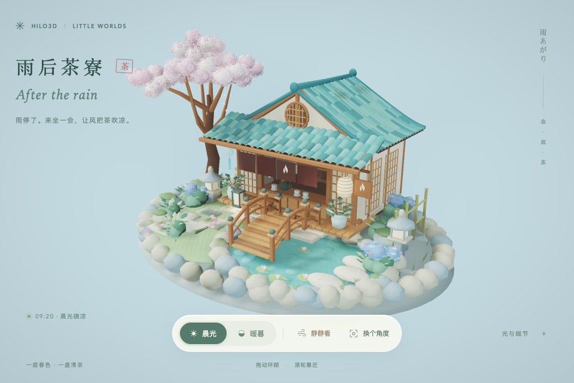

# 雨后茶寮 / After the rain

[打开案例](../examples/rain_tea_garden.html)。在本地运行 `npm run examples:dev`，访问
`/examples/rain_tea_garden.html?backend=webgpu`。

这是一个清新日漫气氛的实时庭院：奶油色墙面、青绿瓦顶、木质廊桥、樱花和绣球环绕浅池，晨光与薄暮两种光照呈现雨后安静的茶寮。建筑、桥、树木和摆件是可环绕查看的三维模型；概念图用于决定构图和配色。



## 从预览到三维场景

先通过 ImageGen 生成下图，再通过 Blender MCP 在 Blender
5.1.2 中搭建原创几何和材质。概念图与生成提示保留在仓库，供比较设计意图；它不是实时场景的截图，也不作为背景图覆盖渲染画面。


[资产目录](../examples/models/RainTeaGarden/README.md)
保留 Blender 创作脚本、可编辑源文件、GLB 和来源记录。运行时只加载本地 GLB，不依赖外部模型下载。Vite 递归发现 HTML 入口，静态示例构建保留运行资产，不复制
`.blend` 创作源文件。

2026-10-13 已通过 Blender MCP 创建并导出 `RainTeaGarden`
场景。当前 GLB 包含 112 个网格、39 个材质和 91,687 个三角形，约 4.93
MB；全部网格提供 UV0，不含外部 URI 或图像贴图。材质和几何来源、可编辑源文件与重建命令见资产目录。以上为文件结构检查结果，实时画面证据另行记录。

## 场景与交互

- 晨光 / 薄暮切换真实场景灯光，保留同一个庭院和相机。
- 间接光使用 `ClusteredForwardPlusPipelineFactory`
  的动态 DDGI；建筑和庭院表面参与光线场景，材质接收间接照明。
- 雨后薄雾使用局部体积和共享阴影图集。关闭薄雾会把局部介质移出可见空间；仍保留相同的 froxel 管线，不能以 froxel 数量变为零作为开关证据。
- 石径与相邻的暖、冷色石块通过 `DecalProjector`
  接收落花、雨湿痕迹和少量苔斑；局部投影体积限定覆盖范围，透明底色保留石材原色。
- 多层透明使用 `weightedBlendedTransparency` 的 HDR 累积、revealage 和合成通道。
- 拖动、滚轮和触摸使用公开 `OrbitControls`；预设视角使用
  `setView()`。页面随窗口尺寸调整，并尊重减少动态效果的偏好。

场景明确要求 WebGPU，因为动态 GI 和体积光依赖 compute/storage 能力。显式 WebGL2 请求或 WebGPU 创建失败会显示错误，不自动切换后端。所有帧经过共享 renderer、Render
Graph 与 portable RHI，案例没有独立实现阴影、GI 或透明渲染器。

场景优先以 2× 像素比例绘制，给细窗格、屋瓦和花瓣足够的空间采样；此策略同时用于正常页面和测试。正常页面的实际绘制尺寸上限为 2560
× 1600；`?test=1` 的上限为 960 × 640（`quality=production`
使用正常上限）。宽高任一触及上限时按窗口比例降低像素比例，窗口缩放后重新计算。这里规定的是像素工作量边界，不承诺帧率或 GPU 内存占用。

离开页面时先停止 ticker，再等待 GPU 提交完成并销毁资源；persisted `pagehide` 保留资源，在 `pageshow`
恢复。

## 验证与证据边界

`test/ui/rain-tea-garden.spec.ts` 接入 `npm run test:webgpu` 和 `npm run test:webgpu:native`，属于
`post-processing` 工作组。测试通过共享 `test/ui/stable-capture.ts`
等待真实提交并采集 compositor 像素，保留 GPU fence、页面/网络/图形错误监控及清理后的观察。

功能对比分为 GI / 薄雾、贴花 / 加权透明两组：同一灯光和相机下比较开关前后的真实画面，并检查 Render
Graph 通道。这里对齐 TAA 相位以隔离功能贡献；它不代替连续画面稳定性验收。

连续帧用例在晨光和薄暮各实际预热 144 帧，然后保持四项功能与 TAA 开启、动态关闭、相机固定，捕获 9 张逐帧提交的图像，覆盖八种 TAA 相位及周期边界。每相邻一对全画面要求平均 RGB 差小于 0.15，任一通道变化超过 6 的像素比例小于 0.5%；不裁剪庭院、不对齐相位、不关闭抗锯齿。相机数值、帧号逐次加一、真实 draw
/ present / queue 提交和 `TemporalAA production resolve` 同时受检。测试专用的
`settle(frames, { keepPaused: true })` 委托共享截图控制持有已提交画面，避免截图间偷跑帧；`finally`
释放后，以自然 ticker 帧和相机输入检查恢复。

2026-10-14 的本地浏览器验收结果如下。软件通道按职责分次运行后覆盖同一组用例，不声称是一次整组命令。

| 通道                         | 结果与范围                                                                     |
| ---------------------------- | ------------------------------------------------------------------------------ |
| 物理 WebGPU，生产画质        | 6 项通过：连续帧、两组功能、相机/窄屏/页面交互、两种暖机导航。                 |
| SwiftShader WebGPU，测试画质 | 同六项组合覆盖通过：连续帧与两种暖机导航 3 项、交互 1 项、两组功能 2 项。      |
| WebGL2 后处理 CI 完整组      | 8 项通过。茶寮本身仍为 WebGPU-only。                                           |
| WebGPU 既有后处理补集        | `post-processing.spec.ts` 的 8 项通过；新增茶寮由上面六项覆盖。                |
| 目录与文档                   | 34 项 UI 合同测试、123 项 WebGL2 分组完整性检查、849 个文档链接/锚点检查通过。 |

物理 WebGPU 连续帧的最大平均 RGB 差为晨光 0.0177、薄暮 0.0210；变化像素比例分别不超过 0.0124% 和 0.0490%。SwiftShader 对应最大值为 0.0326
/ 0.0339，以及 0.0253% / 0.0259%。这是全部效果开启时的相邻帧证据，不是同相位截图的稳定性推断。

软件模拟器在 1920 ×
1280 绘制尺寸及早期串行长用例下曾触发原有 300 秒预算。依据同机 trace，将测试上限限定为 960 ×
640，并按六项职责组织用例；物理测试统一用 `quality=production`
保留 2× 绘制。模型、功能、像素阈值、真实提交、36 帧功能恢复预热及错误/恢复断言均保留，没有增加超时、重试或跳过未验证的用例。详细日志、blob、逐例耗时、原始图像和旧超时记录保留在本地
`reports/rain-tea-garden/`；它们不是性能基线或帧率/显存承诺。

```sh
npm run test:ui:contract
npx jiti scripts/check-ui-groups.ts
BROWSER=none npx playwright test test/ui/rain-tea-garden.spec.ts --project=chromium
BROWSER=none npx playwright test test/ui/rain-tea-garden.spec.ts --project=chromium-native-webgpu
CI=true BROWSER=none HILO3D_UI_GROUP=post-processing npm run test:ui:webgl2:ci
```

上述六项验收之后，窗口缩放保留用户视角与真实初始化异常的资源清理已补充修复。软件与物理 WebGPU 增量运行的交互、初始化故障及两种暖机导航各四项均通过；结合原有连续帧和两组功能测试，两条通道分别组合覆盖当前七项职责。故障用例在首个实际提交后注入错误，检查设备恰好销毁一次、错误可见、API 不提前发布，以及后续页面事件不会重启已销毁的场景。最终修订再次通过物理 WebGPU 晨暮连续帧验收。

补充软件回归曾遇到初始化等待超时；当时资源请求正常，另一次运行还观察到页面重新导航。冻结源码、停止并行重检查后，以仓库既有 CI 配置关闭录像，四项管线/TAA 回归和七项 GI/反射/庭院回归分两次全部通过，没有扩大超时或降低像素阈值。物理 WebGPU 的对应补充回归也通过，包括修正统计合同后的 TAAU 收敛与镜头切换。原始失败、中止、初始化诊断与最终成功记录均保留在本地
`reports/rain-tea-final-*` 和
`reports/rain-tea-initialization-probe.log`，分次覆盖不等同于单次全仓门禁。尚未运行完整发布级
`npm run validate`，也没有新增经审核的性能基线。
