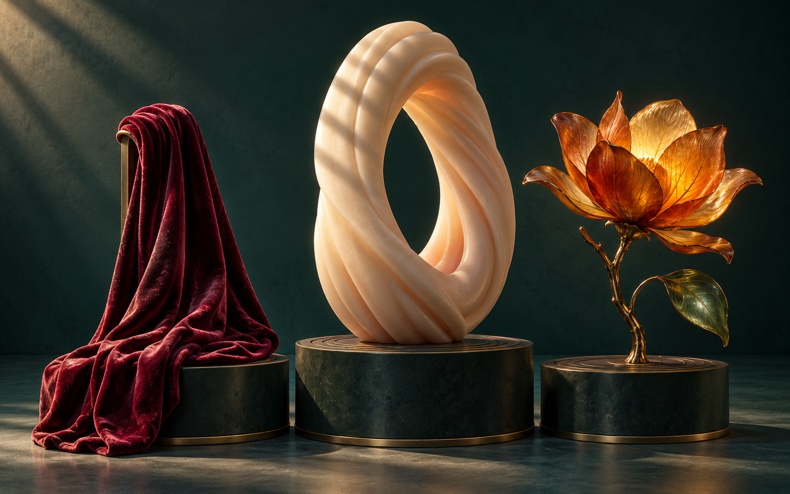
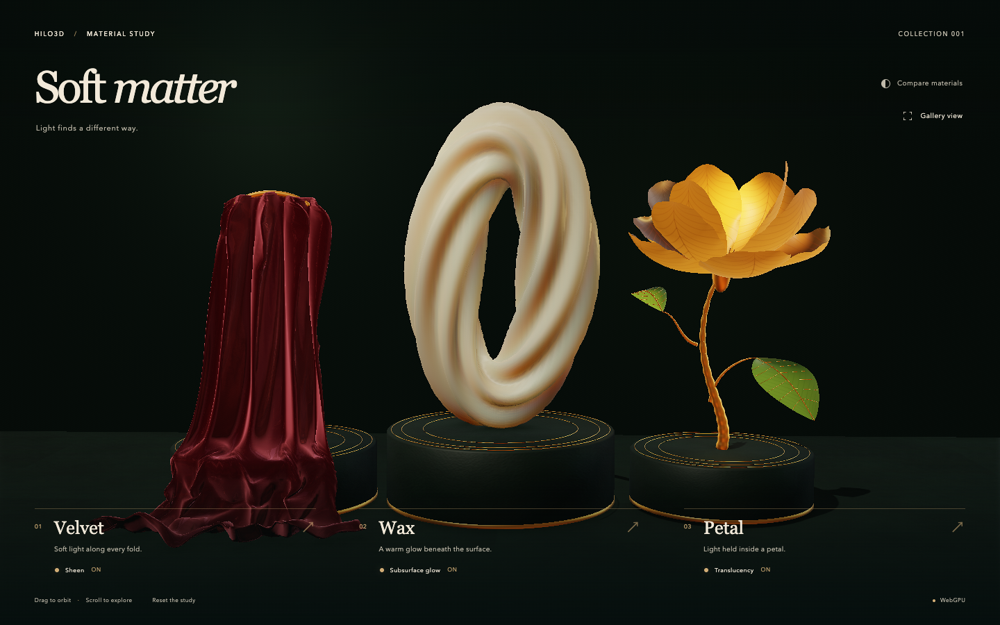

# Soft Matter — a study in material response

[Open the example](../examples/mat1_soft_matter.html). This Unreleased showcase exercises the
[MAT1 surface contract](./MAT1_SURFACES.md) with real geometry, authored maps and shared lighting.

## Art direction

The scene follows an imagegen concept: wine-red velvet, an ivory fluted wax loop and an amber
magnolia on dark verde-stone plinths with aged-brass details. The interactive presentation retains
the reference's composition and palette while rendering every surface through Hilo3D. The concept is
an art target, not a screenshot or a baked replacement for the live scene.



Original models were made in Blender specifically for this example. The editable source is
`examples/assets/mat1-soft-matter/soft-matter.blend`; the browser loads its local GLB. There are 26
editable source meshes, exported as six material batches with 97,740 triangles, with no downloaded
geometry or remote runtime assets. The batching retains every triangle's position, normal, UV and
winding byte-for-byte; it changes only draw grouping.
[Asset notes](../examples/assets/mat1-soft-matter/README.md) describe the UV and material contracts.

The live Hilo3D presentation, captured with the native WebGPU renderer:



## Interactions and visible evidence

- **Velvet**: grazing-angle sheen lights the deep cloth folds. Switching Sheen off changes only the
  sheen color; pigment, lights, geometry and exposure stay fixed.
- **Wax**: RGB profile diffusion softens light/shadow boundaries across the fluted sculpture.
  Switching Subsurface glow off preserves specular lighting and all scene illumination.
- **Petal**: two-sided thin diffuse transmission brings warm light through the petals and green
  leaves. The procedural vein texture modulates pigment, normal and transmission strength; coverage
  remains opaque.
- Select a material's title for a close view. Gallery view restores the complete composition.
  Compare materials disables the three effects together; Reset the study restores the scene.
- Drag and wheel navigation use public `OrbitControls`; preset views use `setView()`.

The six material names in the GLB map to public `PBRMaterial` instances. Velvet and stone maps are
deterministic painted surface details; petal veins also carry a thickness pattern in alpha. No
illumination is baked into these maps. The live scene uses the shared post-process pipeline, profile
SSS, temporal AA, GTAO, directional shadowing, area-light sheen and environment lighting.

## Quality and lifecycle

The display backing surface is capped at 1920×1080 and device pixel ratio. Ordinary `?test=1`
captures cap it at 480×300; `?test=1&quality=production` retains the production pixel budget. Both
use the same geometry, material maps, 25-tap SSS, lighting and interaction. Directional shadow maps
are 1024² for portable captures and 2048² for production.

The screen-space diffusion budget is explicit and matches the largest allowed backing surface.
Unsupported SSS capture or ray-contributor combinations are not enabled by this scene. The camera
always uses a full-output viewport. MAT1 materials opt out of ray-scene contribution while their
shared raster lighting remains active.

Stable screenshots use the repository's shared `test-frame-control` and `stable-capture` contract.
Material comparisons settle actual submissions to the same eight-frame temporal phase. During a
comparison batch, the existing capture adapter holds that phase; every disabled/restored image still
renders a full temporal cycle. The test then explicitly resumes and verifies natural draw progress.
A retained `pagehide` stops submissions without destroying resources; persisted `pageshow` resumes
them. Final disposal stops the ticker/capture first, waits for late initialization and GPU idle,
then releases the stage and owned textures. Late-loaded resources observe cancellation.

## Browser acceptance

`test/ui/mat1-soft-matter.spec.ts` checks each sculpture's own pixel region, restored response,
native draw progress, the compare/reset controls, real camera gestures, resize, retained-page
recovery and errors after final teardown. The original compact `mat1-materials.spec.ts` remains the
independent Forward/Clustered material contract. This example is a featured material study and
belongs to the complete `post-processing` UI group.

Executed results are recorded after final validation. Screenshots and timings are functional
evidence; they do not establish an enrolled performance baseline or image equivalence to the
generated concept.

## Concept provenance

The preview was generated with the built-in image generation tool. Its source was copied unchanged
to `documentation/assets/mat1-soft-matter-concept.png`. The live example does not load this image.

The exact generation prompt was:

```text
Use case: stylized-concept.
Asset type: art-direction preview for a real-time Hilo3D material demonstration, to be reconstructed as actual 3D meshes.
Primary request: an exceptionally art-directed, cinematic still life demonstrating three clearly different material families, with a reproducible restrained composition.
Landscape 16:10. Deep midnight emerald gallery with a seamless dark teal wall and floor. Three sculptural objects sit on closely spaced low charcoal-green cylindrical plinths, arranged as one intimate still life, not three separate panels.
LEFT at 25% width: rich wine-red velvet draped over a vertical narrow curved support, spilling in deep elegant folds down its plinth. Plush pink grazing sheen along folds, dark burgundy body; silhouette approximately 2.4 units high and 1.6 wide. Cloth fabric, never shiny satin.
CENTER at 51% width, tallest hero: a warm ivory wax sculpture shaped as an upright asymmetrical oval loop, an organically twisted ribbed torus with a generous open hole. Silhouette about 3 units high and 2.1 wide. Smooth flowing flutes, rounded edges, peach-red subsurface diffusion where strong light meets shadow. The wax stays matte and solid, no glass transparency. Small narrow diagonal shadows from off-screen slats run across part of the ivory loop to show soft colored diffusion at shadow boundaries.
RIGHT at 77% width: a sculptural botanical branch in aged brass holding one large amber magnolia flower, 9 to 12 broad curved very thin petals with delicate radial veins; petals glow golden-orange in transmitted warm backlight, darker rust at overlapping folds. Two smaller green translucent leaves low on the stem. Flower about 2 units wide, positioned on a slender raised stem.
Restrained small brass details, subtle concentric engraved circles on plinth bases. No clutter. Museum product photography, sculptural editorial lighting: strong warm key from high upper left, soft cool teal fill, warm backlight behind the flower, grounded soft contact shadows. The objects occupy central 78% of frame width and lower 65% height with quiet top negative space. Camera at frontal three-quarter angle, slightly above bases, 65mm lens, all objects in focus. Refined teal/burgundy/ivory/amber palette, nuanced highlight rolloff, beautiful material separation. Convincing real geometry that can be recreated in Blender, modest detail and clean silhouettes. No people, no text, no typography, no labels, no logos, no watermark, no interface, no excessive bloom, no beams or fog, no background foliage.
```
