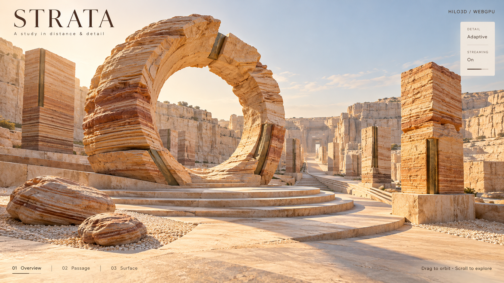
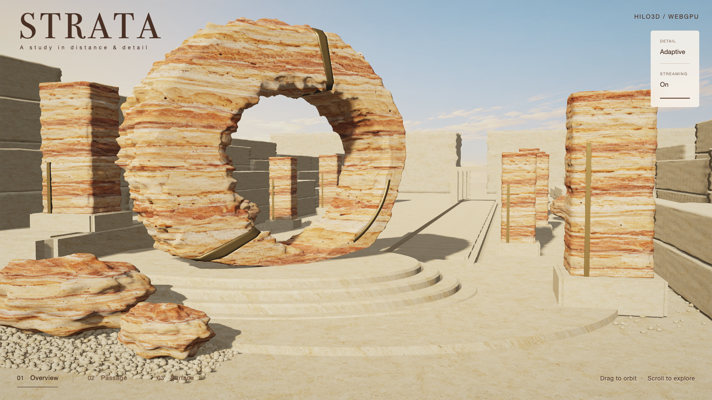

# STRATA / 风蚀石庭

STRATA is a sandstone sculpture garden for the bounded M0 meshlet and geometry-streaming slice. Open
`examples/meshlet_strata.html?backend=webgpu` through `npm run examples:dev`. The example is
featured in the gallery and explicitly requires WebGPU.

## Visual target and comparison

The concept was generated first with the built-in image generator. It established a warm stone
aperture, bronze seams, concentric steps, a receding quarry promenade and a restrained editorial UI.

The fixed concept is 1672×941 pixels. Composition comparisons use that exact viewport at device
pixel ratio 1, with the production geometry and resolution. The implementation uses original
editable Blender geometry, PBR lighting, standard shadow atlases, GTAO, TAA and the existing
volumetric-lighting feature. The saved native runtime capture uses the same 1672×941 dimensions as
the concept. It is an interactive geometry-and-material reconstruction, not a pixel-identical
reproduction: individual erosion marks, silhouettes and lighting still differ from the generated
image.

The original ring silhouette, right-offset opening, low podium ellipse, foreground stone positions
and corridor vanishing point guide the desktop composition. UI placement is measured against the
same concept, including the narrow 114×180-pixel control panel. Surface and Passage use a compact
title treatment; portrait Overview reframes the sculpture. Orbit, wheel and touch use public
`OrbitControls`, and presets use `setView()`.

## Authored content

The editable [Blender scene](../examples/models/Strata/strata.blend), its
[authoring script](../examples/models/Strata/author_strata.py) and
[rebuild/provenance notes](../examples/models/Strata/README.md) accompany the runtime assets.
Blender MCP ran the authoring script in an isolated background process and preserved the previously
open project. The hero is a cut annular stone slab with broad front/back faces, deep side cuts,
chamfered and fractured rims, an asymmetric opening and three bronze repair joints. Sedimentary
ridges, broken edges and granular displacement are real geometry. Carved monoliths, boulders, quarry
walls, complete passage frames, floor, concentric podium and foreground gravel are also meshes.

The validated export contains 213 instances and 1,287,944 instance-weighted source triangles. Its
complete coarse scene contains 889,236 triangles, including ordinary geometry that is not streamed.
The three streamed prototypes contain 314 groups and 1,131 independent pages, totaling 8,520,768
encoded bytes across all authored levels:

| Prototype | Source triangles | Groups | Pages | Encoded bytes |
| --------- | ---------------: | -----: | ----: | ------------: |
| Aperture  |           91,632 |    211 |   749 |     5,724,412 |
| Monolith  |           32,480 |     74 |   291 |     2,060,604 |
| Boulder   |           12,320 |     29 |    91 |       735,752 |

`scene.json` and its referenced manifests remain authoritative. These are content counts, not
performance measurements. The validated content version is
`sha256:edd84f53519347fe3d83b18460af4f788aa419a7e26c5fe2120076745994c58a`.

The current material inputs are the generated `sandstone-weathered.png` and `limestone-quarry.png`.
They supply base color; vertices, normal streams, silhouettes and contact shadows come from the
scene geometry and renderer. The generated `quarry-sky.png` contains sky only and is sampled on an
unlit enclosing sphere. It does not contain the quarry, sculptures, podium or foreground terrain.
See the retained [image-generation prompts](./images/strata/prompts.md) and asset provenance notes
for the authored inputs.

## Streaming and rendering

Each asset first acquires every group's coarsest CPU page, then builds its ordinary fallback with
`createMeshletFallbackGeometry()`. Full source primitive JSON stays in ignored cooking inputs.
Camera distance and projected group error determine finer page demand. Fine leases are released when
no longer needed; setting CPU visibility false alone would retain cached pages and would not reclaim
GPU arena space. Coarse leases stay pinned while the scene is alive.

- **Adaptive** requests useful fine levels and lets the GPU choose complete resident LOD groups.
- **Coarse** releases fine pages while retaining a complete visible scene.
- **Streaming off** cancels fine demand and retains the coarse foundation. Re-enabling it applies
  the current camera's demand.
- **Live geometry** shows actual renderer cluster/residency counters and CPU page accounting.

The aperture bucket has an 8 MiB GPU arena; each other streamed prototype has 4 MiB. Every streamed
bucket admits at most 512 KiB of incremental page/page-table writes per frame and has a bounded
visible-cluster buffer. Each page manager separately budgets 16 MiB of CPU payload/scratch, four
concurrent requests and 256 KiB of decode work per update. These are per-asset limits; ordinary
fallback buffers and shared effects remain separate allocations. Readback is used for UI diagnostics
only and never drives GPU culling or indirect draw arguments. The renderer still follows shared
frontend → Render Graph → portable RHI. See [the M0 contract](./MESHLET_GEOMETRY.md) for initial
allocation/recovery accounting and limits.

Pages and static primitives live in immutable digest directories. A successful offline build
publishes `scene.json` by atomic rename only after every referenced version exists. The content
version includes texture bytes, so rebuilding an albedo also invalidates the image URL.

The production renderer uses two stable shadow cascades and an authored receiver-bias range suited
to this scene's world-space extent. A `shadows=0` diagnostic query was used to isolate self-shadow
striping before calibrating the bias; default captures and acceptance keep the shadows enabled. Warm
directional lighting and cooler fill illuminate the PBR surfaces. Distance haze uses the pipeline's
existing froxel volumetric-lighting feature. The current showcase does not enable the
physical-atmosphere, procedural cloud or cloud-shadow passes; its sky is the separate sky-only
texture described above.

## Lifecycle and capture

Page suspension pauses the ticker and controls while preserving resources. A persisted `pageshow`
resumes the same scene. Final teardown stops scheduling first, cancels requests, drains pending
diagnostics/submissions and releases scene/texture resources; cleanup failures remain observable.

Initial fine-detail readiness follows the currently active lease identities. Resizing or changing
the view while a real response is pending can replace those leases; cancellation of a superseded
lease does not dispose the scene. Readiness then waits for the replacement demand. Network or decode
errors belonging to a still-current lease retain the normal fatal error path.

`?test=1` installs the shared capture controller. The software profile caps the backing dimensions
at 640×400 and shadow slices at 1024 pixels. It uses the same scene, pages, material shaders,
lighting, submissions and interactions. `?test=1&quality=production` retains full output and shadow
resolution. No global time/randomness replacement or fake draw completion is used.

`scripts/geometry/preview-strata.ts` saves submitted native-GPU Overview, Passage, Surface and
portrait captures through `test/ui/stable-capture.ts`. Desktop captures use the original 1672×941
concept dimensions; `--without-shadows` is an explicit diagnostic comparison. The reference and
runtime images remain separate artifacts.

## Validation

On 2026-10-29 the startup-lease correction passed its new real-HTTP-gated regression in software
(one case, 1.2 minutes) and native production (one case, 13.7 seconds). The regression reproduced an
`AbortError` and disposed scene on the old native implementation when resizing during initial fine
loading. The fixed implementation preserves the live scene and follows replacement demand.

The complete three-case native suite then passed in 57.7 seconds, with unchanged timeouts and pixel
thresholds, no retries and no skips. It covers the same visual content version listed above plus the
initialization fix. The full `npm run test:webgpu` software matrix subsequently passed all 37 cases,
including all three STRATA cases, in 29.5 minutes with no skips or unexpected failures. Suite
durations are local execution times, not GPU benchmarks.

All six WebGL2 hosted-UI groups also passed locally through the shared CI runner: 123 tests across
catalog, catalog-scenes, CSM, physics, post-processing and chromatic. Each receipt in ignored
`reports/strata-ui-ci-fixed/` records `status: passed` and `sourceUnchanged: true`. The complete
WebGPU JSON result is `reports/strata-validation/full-webgpu.json`.

These broad gates used HEAD and fetched `origin/dev` at `df0d45528eb032957b420f19dc2067cfa9199355`
plus the unchanged tested working tree fingerprint
`5aa3d2d7fd4ed68c2e1ab6a952faac1bf5fe4ce12da6f4ab7683e47e09e60979`. This documentation record was
updated after those runs; the visual asset content version above is unchanged.

The dedicated cases observe actual HTTP Request identities and completion generations, including
refetches; they do not replace fetch or preread response bodies. They retain real GPU submission,
shaded pixels, post-capture pointer/wheel input, preset changes, portrait layout, BFCache
pause/resume and post-disposal error observation.

The current native screenshots and streaming-evidence attachments are retained under ignored
`reports/strata-all-fixed-native/` and `reports/strata-all-fixed-native-html/`. The earlier two-case
`reports/strata-validation/software-yaw/` and `native-yaw/` passes predate the startup correction
and remain historical evidence. Earlier `software-final/`, `native-final/`, `software-ci/` and
`native-production/` reports also remain separate. Resident page/cluster counters demonstrate
selection and refetch behavior; they are not hardware memory measurements or enrolled performance
comparisons.

The real-GPU regression suite exercises positive-error near/far LODs with both levels resident,
multiple materials/instances, mirrored and sheared transforms, material compatibility transitions
and release-driven GPU page handoff. The showcase has also exposed opaque shadow texture binding and
near-flat Float32 cone-generation boundaries, covered by targeted regressions. Current-source
evidence does not include running the complete `npm run validate` aggregate, the entire native
WebGPU matrix or an enrolled performance benchmark. Local CI-profile runs also do not establish a
hosted Linux driver result. Remaining M0 work is tracked in [ROADMAP](./ROADMAP.md).
